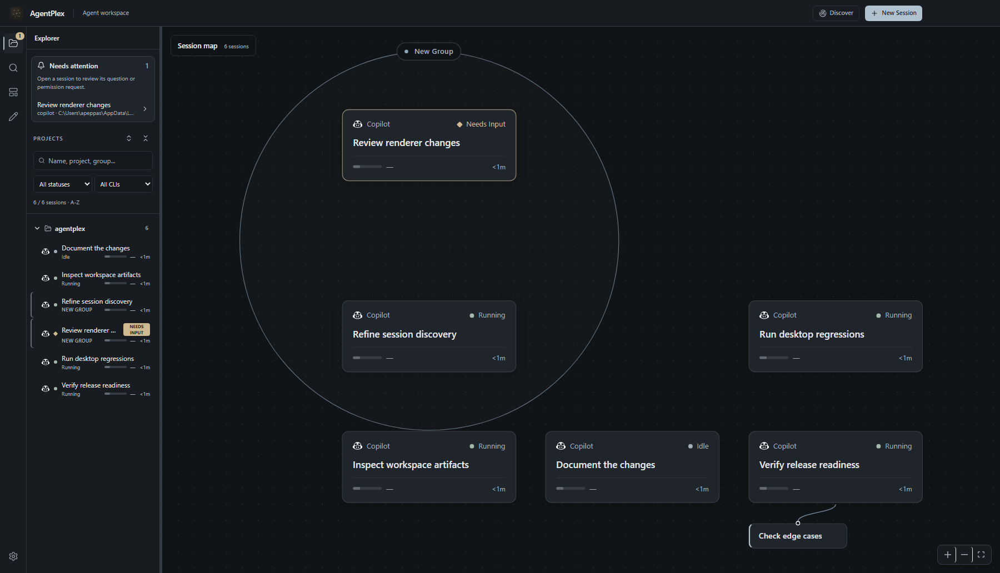
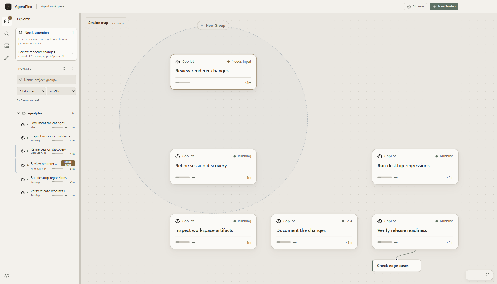

<p align="center">
  
</p>

<h1 align="center">AgentPlex</h1>

<p align="center">
  Multi-session Claude/Codex/GitHub Copilot CLI orchestrator with graph visualization.
</p>

<p align="center">
  <a href="https://github.com/AlexPeppas/agentplex/releases/latest"><strong>Download for Windows</strong></a> &nbsp;|&nbsp;
  <a href="#build-from-source">Build from source</a>
</p>

---

## Requirements

- [Claude CLI](https://docs.anthropic.com/en/docs/claude-cli) installed and authenticated
- [GitHub CLI](https://cli.github.com/) with Copilot extension (`gh copilot`) installed and authenticated

## Quick Start

Download **AgentPlex.exe** from the [latest release](https://github.com/AlexPeppas/agentplex/releases/latest) and run it. That's it.

> **macOS / Linux**: Pre-built binaries coming soon. For now, [build from source](#build-from-source).

## Installation

<a id="build-from-source"></a>

If you prefer to build from source instead of using the installer:

```bash
git clone https://github.com/AlexPeppas/agentplex.git
cd agentplex
pnpm install
pnpm start
```

To build a distributable installer:

```bash
pnpm make
```

### Updating a source checkout

After pulling changes, install the dependencies before starting AgentPlex:

```bash
git pull --ff-only
pnpm install --frozen-lockfile
pnpm start
```

`git pull` updates the source and lockfile, but does not install new dependencies.
Run the install command in each checkout or worktree you launch, even if it
already has a `node_modules` directory.

### Troubleshooting: startup stuck building the main target

If `pnpm start` finishes building preload but stays at `Building ... main.ts target`,
the checkout may be missing a newly added dependency such as `sanitize-html`.
Cancel only the stalled startup command with Ctrl+C, then run:

```bash
pnpm install --frozen-lockfile
pnpm start
```

Startup now checks runtime dependency entry points before launching the build
and reports missing or incomplete packages with these recovery commands.
If installation fails, address the reported installation error before retrying
startup. This recovery does not require deleting session data or resetting
configuration. These instructions apply to source checkouts, not the packaged EXE.

### Global CLI shortcut (optional)

```bash
pnpm link --global   # one-time setup
agentplex            # launch from anywhere
```

To remove: `pnpm unlink --global agentplex`

### Native file previews

Open a file from the session workspace tree, or click a supported local file path
in terminal output, to preview it in a read-only session tab. Markdown links can
also open other local files within the session workspace.

| Files | Preview |
| --- | --- |
| `.md`, `.markdown` | Formatted Markdown, tables and fenced Mermaid diagrams |
| `.json` | Formatted JSON with explicit parse errors |
| `.html`, `.htm` | Sandboxed HTML with scripts, navigation and network resources disabled |
| `.pdf` | Native PDF reader with page navigation and zoom |
| `.csv`, `.tsv` | Scrollable tables preserving quoted and multiline values |
| `.docx` | Word headings, paragraphs, lists and tables; not exact page layout |
| `.doc` | Legacy Word text, including headers, footers and notes; no original page layout |
| `.xlsx` | Workbook sheet tabs and cell values; formulas show saved results and are never calculated |
| `.mmd`, `.mermaid` | Locally rendered Mermaid diagram with a source toggle |
| `.txt`, `.log`, `.yaml`, `.yml`, `.xml`, `.toml`, `.ini`, `.conf`, `.config`, `.jsonl`, `.ndjson` | Plain text |
| Common source files (`.ts`, `.tsx`, `.js`, `.jsx`, `.py`, `.go`, `.rs`, `.java`, `.c`, `.cpp`, `.cs`, `.css`, `.sql`, `.sh`, `.ps1`, etc.) | Read-only source text, never executed |

Text files are limited to **1 MiB**, decoded as UTF-8 or BOM-marked UTF-16.
PDF and Office input files are limited to **20 MiB**. Office conversion runs in
bounded background workers with a 15-second timeout; ZIP-based Office documents
are limited to 2,000 archive entries and 40 MiB of expanded content. Extracted
Word output is limited to 2 MiB.

Table previews show at most 1,000 rows and 100 columns per sheet, 20 sheets and
20,000 cells total; a notice identifies truncated previews. Word images, embedded
objects and active links are disabled. Encrypted documents and legacy `.xls`
workbooks are not supported. Mermaid configuration directives, interactive links
and network references are disabled; diagrams are limited to 50,000 characters
and 500 edges. Unsupported, malformed and oversized files show an explicit error.

Previews remain scoped to the selected workspace and that session's artifact
directory. They do not require Microsoft Office or an external editor.

## Dev Requirements

Building from source requires [Node.js](https://nodejs.org/) 20+ and native build tools for `node-pty`:

- **Windows**: [Visual Studio Build Tools](https://visualstudio.microsoft.com/visual-cpp-build-tools/) with "Desktop development with C++"
- **macOS**: `xcode-select --install`
- **Linux**: `sudo apt install build-essential python3`

pnpm is pinned via `packageManager` in package.json. If you have [corepack](https://nodejs.org/api/corepack.html) enabled (`corepack enable`), it will auto-install the correct version. Otherwise install pnpm directly: `npm install -g pnpm`.

## Features

- **Multi-session management** — run multiple Claude/Codex/Copilot CLI sessions side by side
- **Graph canvas** — drag, arrange, and connect session nodes on a visual canvas
- **HITL notifications** — get notified when a CLI session requires human input
- **Cross-session messaging** — send messages between sessions with optional GitHub Copilot or Haiku summarization
- **Sub-agent tracking** — visualize spawned sub-agents via JSONL transcript tailing
- **Plan & task visualization** — see plans and task lists rendered in the graph
- **Session resume** — resume previous Claude and Copilot sessions from the same launcher UX
- **External session adoption** — discover and adopt running Claude/Copilot sessions
- **Graphite dark / Stone light** — muted paired themes for the graph, explorers, and toolbar
- **Inline rename** — double-click any node to rename it

Switch between Graphite and Stone in **Settings**; your choice persists across
launches. Terminal output and Git diff editors remain dark in both themes to
preserve CLI and code readability.

| Graphite (dark) | Stone (light) |
| --- | --- |
|  |  |
| [Workspace and file preview](assets/graphite-workspace-preview.png) | [Workspace and file preview](assets/stone-workspace-preview.png) |

> Captured from the production renderer with synthetic sessions and an isolated
> workspace. Click an image for the full-size view. Session cards show live state,
> waiting sessions use a diamond indicator, and the graph dock provides zoom and
> fit controls. Hover or keyboard-focus a card to reveal its actions.

## Configuration

### Cross-session summarization (optional)

When the source session is Copilot, summarization uses an enabled low-cost model from your GitHub Copilot account through an isolated inference-only SDK proxy. Authenticate with `gh auth login`, or supply `COPILOT_GITHUB_TOKEN`, `GH_TOKEN`, or `GITHUB_TOKEN`. Copilot CLI must be installed. No Anthropic API key or HTTP proxy listener is required; Copilot account usage charges apply.

For other source CLIs, enable Haiku summarization by setting your Anthropic API key using `AGENTPLEX_API_KEY` (not `ANTHROPIC_API_KEY`, which would conflict with Claude CLI's auth).

**Set it persistently (recommended):**

```bash
export AGENTPLEX_API_KEY=sk-ant-...       # macOS/Linux (~/.bashrc or ~/.zshrc)
set AGENTPLEX_API_KEY=sk-ant-...          # Windows (cmd)
$env:AGENTPLEX_API_KEY="sk-ant-..."       # Windows (PowerShell)
```

**Or inline when launching from source:**

```bash
AGENTPLEX_API_KEY=sk-ant-... pnpm start                          # macOS/Linux
$env:AGENTPLEX_API_KEY="sk-ant-..."; pnpm start                  # Windows (PowerShell)
```

Without summarization credentials, cross-session messaging still works: uncheck summarization to send raw terminal context. Summary failures are shown in the send dialog and do not silently broadcast raw context. Summaries use the provider's persisted conversation, falling back to the terminal buffer when no conversation is available.

## Usage

1. **Create sessions** — click "+ New Session" and pick a working directory
2. **Arrange nodes** — drag session nodes freely on the canvas
3. **Rename** — double-click a node label to rename it
4. **Send messages** — hover a node, click the send icon to share context with another session
5. **Resume** — use "Resume" under Claude or Copilot to continue a previous session

The Explorer also provides a **Needs attention** box for sessions waiting for input.
Click an item to review its terminal; this does not automatically approve requests.
Search by session name, project path, CLI, or group, and combine status and CLI
filters. Projects and sessions stay alphabetically ordered as activity changes.
Session creation remains in the main toolbar and project context menus.

For Copilot, **Running** follows assistant turns and tool execution, **Needs
attention** means an unresolved permission or `ask_user` request, and **Idle**
means the turn has ended or been cancelled. Terminal prompt text, redraws, and
quiet periods during long-running work do not change Copilot's lifecycle status.

Copilot token readings are labeled **snapshot**: they come from the main
conversation's prompt-cache checkpoint, successful compaction, or CLI shutdown.
Hover for the exact count, source, and timestamp. Auxiliary model calls are
excluded. These snapshots can lag `/context`; no pressure percentage is shown
without a reliable context-window capacity.

Terminal fullscreen and split-pane resizing preserve the mounted terminal.
Desktop resizes wait for settled layout and queued output before synchronizing
the PTY and repainting. Windows sessions use the correct PTY compatibility
settings to preserve scrollback when the terminal grows.

Select terminal text and press **Ctrl+C** (Windows/Linux) or **Cmd+C** (macOS)
to copy. **Ctrl+Shift+C/V** also copies/pastes on Windows/Linux. If a CLI captures
mouse input, hold **Shift** while dragging to select text. Right-click copies
selected text; without a selection it pastes into writable sessions. Ctrl+C
without selected text still interrupts the CLI. Copying also works in read-only
discovered sessions.

CLI-native copy actions, including Copilot's `/copy` command, can write text to
the system clipboard through OSC 52 in visible, writable terminals. Clipboard
reads, saved-output replay, and read-only transcript monitors cannot access the
clipboard through terminal escape sequences. Clipboard writes are limited to
1 MiB of UTF-8 text.

## Project Structure

```
agentplex/
├── src/
│   ├── main/                # Electron main process
│   │   ├── main.ts          # App entry point & window management
│   │   ├── session-manager.ts   # PTY session lifecycle
│   │   ├── ipc-handlers.ts      # IPC bridge between main & renderer
│   │   ├── jsonl-session-watcher.ts # Claude/Copilot event tailing (sub-agent, plan, tasks, HITL)
│   │   ├── plan-task-detector.ts # Claude terminal parsing for plan/tasks
│   │   ├── claude-session-scanner.ts # Claude project/session discovery + transcript rendering
│   │   └── copilot-session-scanner.ts # Copilot project/session discovery + transcript rendering
│   ├── preload/
│   │   └── preload.ts       # Context bridge for renderer
│   ├── renderer/
│   │   ├── App.tsx           # Root React component
│   │   ├── store.ts          # Zustand state management
│   │   ├── components/       # UI components
│   │   │   ├── GraphCanvas.tsx   # React Flow canvas
│   │   │   ├── SessionNode.tsx   # Session graph node
│   │   │   ├── SubAgentNode.tsx  # Sub-agent graph node
│   │   │   ├── GroupNode.tsx     # Group container node
│   │   │   ├── SendDialog.tsx    # Cross-session messaging
│   │   │   ├── TerminalPanel.tsx # xterm.js terminal
│   │   │   ├── Toolbar.tsx       # Top toolbar
│   │   │   └── StatusIndicator.tsx
│   │   └── hooks/
│   │       └── useTerminal.ts    # Terminal lifecycle hook
│   └── shared/               # Shared utilities
│       ├── ansi-strip.ts
│       └── ipc-channels.ts
├── styles/
│   └── index.css             # Global styles
├── bin/
│   └── agentplex.mjs         # CLI entry point
└── package.json
```

## Tech Stack

| Layer | Technology |
|-------|-----------|
| Desktop shell | [Electron](https://www.electronjs.org/) |
| UI framework | [React](https://react.dev/) |
| Graph canvas | [React Flow](https://reactflow.dev/) |
| Terminal | [xterm.js](https://xtermjs.org/) |
| State | [Zustand](https://zustand-demo.pmnd.rs/) |
| PTY backend | [node-pty](https://github.com/microsoft/node-pty) |
| Summarization | [Anthropic SDK](https://docs.anthropic.com/en/docs/sdks) (optional) |

## Contributing

See [CONTRIBUTING.md](CONTRIBUTING.md) for guidelines.

## License

[MIT](LICENSE)
